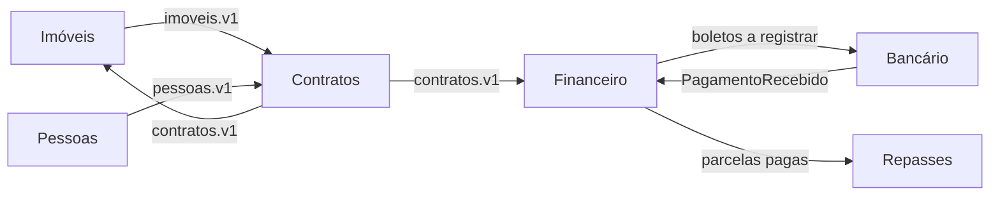

# Sistema imobiliário

SaaS multi-tenant para imobiliárias que alugam e vendem imóveis de terceiros. Várias imobiliárias usam a mesma instalação, e cada uma enxerga só os próprios dados. O sistema cobre o ciclo completo da locação, do cadastro do imóvel ao boleto pago e ao repasse para o proprietário.

É um projeto de estudo: o objetivo é exercitar, num domínio com regras reais, os problemas que aparecem em sistemas distribuídos de verdade.

> **Status:** em desenvolvimento. Infraestrutura pronta; o primeiro serviço (Imóveis) está em construção. Veja o [roteiro](#roteiro).

## O que o sistema faz

- **Imóveis:** catálogo, proprietários com percentual de posse, ofertas de locação e venda, busca.
- **Pessoas:** proprietários, inquilinos, fiadores, compradores e corretores, com dados pessoais protegidos conforme a LGPD.
- **Contratos:** propostas, contratos de locação e venda, garantias, aditivos, reajuste pelo IGP-M ou IPCA, renovação e encerramento, seguindo a Lei do Inquilinato (Lei 8.245/91).
- **Financeiro e bancário:** parcelas, multa e juros, boletos via API ou arquivos CNAB 240/400, confirmação de pagamento.
- **Repasses:** valor ao proprietário, descontada a taxa de administração, e comissões de corretores.
- **Relatórios e notificações:** inadimplência, extrato do proprietário, informe de rendimentos, DIMOB, régua de cobrança por e-mail e WhatsApp.

## Destaques técnicos

- **Microsserviços orientados a eventos:** Kafka em modo KRaft, eventos em Avro com Schema Registry e compatibilidade verificada no build.
- **Consistência eventual:** transactional outbox, consumidores idempotentes, sagas coreografadas e tratamento de eventos fora de ordem.
- **Multi-tenant com isolamento no banco:** Row Level Security do Postgres, além do filtro na aplicação.
- **Segurança:** OIDC com Keycloak e BFF, validação do token e do tenant em cada serviço.
- **Integração bancária por portas e adaptadores:** API REST e CNAB atrás da mesma porta, com um banco fake para testes.
- **Domínio rico:** regras de negócio no agregado, package by feature com vertical slice dentro de cada área.
- **Testes com dependências reais:** Postgres e Kafka via Testcontainers, regras de arquitetura com ArchUnit, TDD.

## Arquitetura

Cada serviço é dono dos seus dados (um database por serviço) e se comunica com os outros por eventos. O fluxo principal da locação:



| Serviço | Responsabilidade |
|---|---|
| Imóveis | Catálogo, proprietários, ofertas, busca |
| Pessoas | Partes envolvidas, contatos, dados bancários, LGPD |
| Contratos | Propostas, locação e venda, garantias, reajuste, encerramento |
| Financeiro | Parcelas, multa e juros, baixa, acerto final |
| Bancário | Boletos via API e CNAB, normaliza os pagamentos recebidos |
| Repasses | Repasse ao proprietário e comissões |
| Índices | IGP-M e IPCA da API do Banco Central |
| Documentos | PDFs de contratos e boletos |
| Notificações | E-mail e WhatsApp |
| Relatórios | Projeções (CQRS) montadas a partir dos eventos |
| Tenants e BFF | Cadastro das imobiliárias; porta de entrada do front-end |

## Stack

- **Back-end:** Java 25, Spring Boot 4, Gradle multi-módulo.
- **Dados e mensageria:** Postgres com PostGIS e Flyway; Kafka (KRaft) com Confluent Schema Registry e Avro.
- **Infraestrutura:** Docker Compose, Keycloak, Traefik, Redis, MinIO, Mailpit.
- **Observabilidade:** OpenTelemetry, Grafana, Tempo e Loki.
- **Testes:** JUnit, AssertJ, Testcontainers, Awaitility, ArchUnit.
- **Front-end (planejado):** Angular.

Nem tudo já está no projeto: cada peça entra na etapa em que passa a ser necessária.

## Como rodar

Pré-requisitos: Docker com o plugin Compose e JDK 25.

```bash
# infraestrutura local (Postgres, Kafka, Schema Registry, Kafka UI)
cd imobiliaria/infra
cp .env-exemplo .env
docker compose up -d
docker compose ps        # espere todos ficarem healthy

# build e testes (Testcontainers sobe os próprios containers)
cd ..
./gradlew build
```

Portas, usuários do banco, reset do ambiente e comandos úteis estão em [`imobiliaria/docs/infra.md`](imobiliaria/docs/infra.md).

## Estrutura do repositório

```
imobiliaria/
  servicos/       um módulo Gradle por serviço (hoje: imoveis)
  infra/          docker-compose.yml e configurações
  docs/           documentação de referência
  .claude/rules/  convenções e decisões de arquitetura, por tema e por serviço
```

## Roteiro

| Etapa | Entrega | Status |
|---|---|---|
| 1 | Infraestrutura base: Postgres, Kafka, Schema Registry | ✔ |
| 2 | Imóveis: RLS, validação de token, outbox | em andamento |
| 3 | Identidade: Keycloak e Traefik | |
| 4 | Pessoas: primeiro consumidor de eventos | |
| 5 | Contratos: máquina de estados e Lei do Inquilinato | |
| 6–8 | Financeiro, Bancário e Repasses | |
| 9–11 | Índices, Documentos, Notificações e Relatórios | |
| 12 | Tenants e BFF | |
| depois | Front-end em Angular, mídia do imóvel, Auditoria | |

As tarefas de cada etapa ficam nas [issues](https://github.com/igorpadua/sistema-imobiliario/issues) e no board do projeto.

## Documentação

- [Infraestrutura local](imobiliaria/docs/infra.md)
- [Decisões em aberto](imobiliaria/docs/decisoes-em-aberto.md)
- [Padrões de projeto](imobiliaria/docs/padroes-de-projeto.md)
- [Glossário](imobiliaria/docs/glossario.md)
- Convenções e decisões de cada serviço: [`imobiliaria/.claude/rules/`](imobiliaria/.claude/rules/)

## Licença

[AGPL-3.0](LICENSE)
